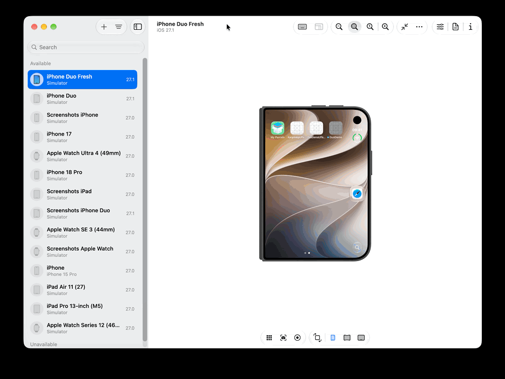

# Changing the iPhone Duo simulator fold state from UI tests

Xcode 27.1 doesn't give you a command-line or XCTest API to fold or unfold the iPhone Duo
simulator. The only built-in control is the pose buttons/hinge slider in **Device Hub**.
This repo has a small host tool that sends the same event Device Hub sends, plus a bridge
so a UI test can switch the fold state in the middle of a test.

Tested with Xcode 27.1 (27A9275), iOS 27.1 simulator runtime (24A94232), "iPhone Duo"
(`iPhone19,4`). Device Hub does **not** need to be running.



## Quick start

```bash
# 1. Build the host tool (once)
clang -fobjc-arc -framework Foundation -o tools/duo-hinge tools/duo-hinge.m

# 2. Change the fold state of a booted iPhone Duo
tools/duo-hinge closed          # 0°   folded, cover display
tools/duo-hinge half            # 130° half unfolded (Device Hub's half-open preset)
tools/duo-hinge flat            # 180° fully unfolded, inner display
tools/duo-hinge 95              # any angle from 0 to 180
tools/duo-hinge -d <UDID> flat  # pick the simulator (default: the booted device named "*Duo*")

# 3. Run the demo UI tests (starts the bridge, runs xcodebuild test, stops the bridge)
DuoDemo/run-ui-tests.sh [<UDID>]
```

The demo test also attaches a screenshot after each change. See
[Taking screenshots](#taking-screenshots) for how to view them.

What you see on the simulator:

| Command | Angle | CoreMotion `hingeState` | Active display | App window (pt) |
|---|---|---|---|---|
| `closed` | 0° | `Closed` | cover | 466 × 678 |
| `half` | 130° | `PartiallyOpen` | inner | 951 × 669 |
| `flat` | 180° | `OpenFlat` | inner | 951 × 669 * |

\* Measured in the app at `half`. `flat` uses the same inner display (2007 × 2853 px @3x), and
the demo test checks that the app is on the inner display in both states.

Each call takes about 1–1.5 s. The state stays after the tool exits.

## Adding it to your own project

The UI test runner runs *inside* the simulator, and the fold event can only be sent from
the Mac (see "Why a host tool" below). So the test makes an HTTP call to a small server on
the Mac, and the server runs `duo-hinge`. The simulator shares the Mac's network, so
`127.0.0.1` reaches it.

1. **Copy the host tools** into your repo (for example into `tools/`) and build the CLI once:

   ```bash
   cp path/to/iphoneduo/tools/duo-hinge.m path/to/iphoneduo/tools/duo-hinge-server.py tools/
   clang -fobjc-arc -framework Foundation -o tools/duo-hinge tools/duo-hinge.m
   ```

   `duo-hinge-server.py` looks for `duo-hinge` in its own folder, so keep the two together.
2. **Copy `DuoDemo/DuoDemoUITests/DuoFold.swift` into your UI test target.** It's the only
   file the tests need. It contains:
   - `DuoFold.set(...)` to change the fold state
   - `DuoDisplay` and `attachScreenshot(_:of:)` to take screenshots of either screen
3. **Run the server while the tests run.** You can copy `DuoDemo/run-ui-tests.sh` and
   change the project, scheme and `TOOLS` path, or do it by hand:

   ```bash
   tools/duo-hinge-server.py --port 8765 &
   xcodebuild test -project MyApp.xcodeproj -scheme MyApp \
     -destination "platform=iOS Simulator,id=<UDID>"
   kill %1
   ```

   If you run tests from Xcode (⌘U), start the server in a terminal first and leave it
   running. If you change the port, set `DuoFold.serverPort` to match.

`http://127.0.0.1` needs no App Transport Security exception, because ATS doesn't apply to
IP-address hosts.

## Changing the fold state

### Before the tests start

There are two ways to do this:

- **From the terminal, before running the tests.** You don't need the server for this:

  ```bash
  tools/duo-hinge -d <UDID> flat
  xcodebuild test …
  ```

  The state stays when apps launch and between tests. So every test starts unfolded,
  unless a test changes it.
- **From the test, in `setUp()`.** This needs the server. Use it when each test should
  start from its own known state:

  ```swift
  override func setUp() {
      continueAfterFailure = false
      DuoFold.set(.closed)   // set the state before the app launches
      app.launch()
  }
  ```

The fold state isn't reset automatically, either between tests or between runs. If a test
cares about the starting state, set it in that test's `setUp()`.

### During a test

Call `DuoFold.set` anywhere in a test:

```swift
DuoFold.set(.closed)       // .closed / .half / .flat
DuoFold.set(degrees: 95)   // any angle from 0 to 180
```

It sends the simulator's own `SIMULATOR_UDID`, so it works with several simulators booted.
It fails the test if the server isn't reachable or the change failed.

The call returns once the simulator has received the event, but the switch between
displays is animated. Wait for your UI to update, for example with an
`XCTNSPredicateExpectation` on a label, instead of using a fixed sleep. The demo test's
`waitFor(_:label:)` shows how.

## Taking screenshots

The iPhone Duo has two screens, and only one is on at a time:

| Fold state | Screen that's on | Screen that's off |
|---|---|---|
| `closed` | **cover** (outside screen) | inner, captures as all black |
| `half`, `flat` | **inner** (inside screen) | cover, captures as all black |

You decide which screen to capture. Usually that's the one that's on for the state you
just set. Capturing the screen that's off isn't an error, but you'll get a black image.

### In a UI test

`DuoFold.swift` adds two helpers:

```swift
// Attach a screenshot to the test result (kept even when the test passes):
attachScreenshot("checkout-folded", of: .cover)
attachScreenshot("checkout-unfolded", of: .inner)

// Or get the screenshot itself and do what you want with it:
let shot = DuoDisplay.inner.screenshot()   // XCUIScreenshot
let image = shot.image                     // UIImage
```

A typical step changes the state, waits for the UI, then captures the screen that's on:

```swift
DuoFold.set(.flat)
waitFor(app.staticTexts["displayName"], label: "Inner display")
attachScreenshot("2-flat", of: .inner)
```

To capture both screens, for example to show the whole device, call it once for each:

```swift
for display in DuoDisplay.allCases {
    attachScreenshot("half-\(display)", of: display)
}
```

To keep a screenshot only when the test fails, pass `lifetime: .deleteOnSuccess`.

Use `DuoDisplay` rather than `XCUIScreen.main`. On the iPhone Duo, `XCUIScreen.main` is
always the cover screen, so in `half` and `flat` it returns a black image.
`DuoDisplay` captures both screens and picks the cover (the smaller one) or the inner
screen by size.

| Screen | Screenshot size (px) |
|---|---|
| cover | 1398 × 2034 |
| inner | 2006 × 2852 |

### Viewing the screenshots

- **In Xcode:** after the tests run, open the Report navigator (⌘9) and select the test
  run. Expand the test: its screenshots are listed in order under it, and you can click
  one to preview it.
- **From the command line:** save a result bundle, then export its attachments:

  ```bash
  DuoDemo/run-ui-tests.sh <UDID> -resultBundlePath ~/Desktop/duo.xcresult
  xcrun xcresulttool export attachments --path ~/Desktop/duo.xcresult --output-path ~/Desktop/duo-shots
  open ~/Desktop/duo-shots
  ```

  The exported files have random names. `manifest.json` in the same folder maps each file
  to the name you gave it (for example `2-flat`). Delete an old `.xcresult` before
  reusing its path.

### From the terminal, outside a test

`simctl` can capture either screen of a booted Duo:

```bash
xcrun simctl io <UDID> screenshot --display=1 cover.png   # cover screen
xcrun simctl io <UDID> screenshot --display=3 inner.png   # inner screen
```

With no `--display`, `simctl` captures the cover screen. These screenshots also include
the home screen and other apps, not just your app. In landscape poses they come out
rotated, for example 2853 × 2007 for the inner screen when `flat`.

## Demo project

`DuoDemo/` was generated with XcodeGen (`project.yml`; run `xcodegen generate` to
regenerate it).

- `DuoDemo/DuoDemoApp.swift`: an app that shows its window size and whether it's on the
  cover or the inner display.
- `DuoDemoUITests/DuoFoldUITests.swift`: goes closed → flat → half → closed in one test.
  After each change it checks the app's on-screen labels and attaches a screenshot of the
  screen that's on (`1-closed`, `2-flat`, `3-half`, `4-closed-again`). It passes from the
  command line on a headless (`simctl boot`) simulator with Device Hub closed:

  ```
  $ DuoDemo/run-ui-tests.sh BE815DFB-20AF-441A-8133-196D6513E1F0
  [duo-hinge-server] "GET /hinge?state=closed&udid=BE815DFB-… HTTP/1.1" 200 -
  [duo-hinge-server] "GET /hinge?state=flat&udid=BE815DFB-…   HTTP/1.1" 200 -
  [duo-hinge-server] "GET /hinge?state=half&udid=BE815DFB-…   HTTP/1.1" 200 -
  [duo-hinge-server] "GET /hinge?state=closed&udid=BE815DFB-… HTTP/1.1" 200 -
  Test Case '-[DuoDemoUITests.DuoFoldUITests testSwitchingFoldStatesDuringTest]' passed (12.396 seconds).
  ** TEST SUCCEEDED **
  ```

## How it works

When you click a pose in Device Hub, this happens:

```
Device Hub (CoreDevicePopDeviceKitExtension.devicekitplugin, "HingeController")
  └─ CoreDevice  HIDVendorDefined.send(usagePage:usage:version:data:)  → IndigoHIDVendorDefined
       └─ CoreDeviceService / SimulatorCoreDevicePlugin:
            SimDevice lookup:"com.apple.coredevice.feature.remote.hid.vendordefined"
            → xpc_endpoint_create_mach_port_4sim → xpc_connection_create_from_endpoint
            → xpc_connection_enable_sim2host_4sim
──────────── host / simulator boundary ────────────
  dtuhidd   (/usr/libexec/dtuhidd, launchd job com.apple.coredevice.dtuhidd)
    └─ VendorDefined HID event on its "avpCustom(0x500)" virtual service
         usagePage 0xFF61 (65377), usage 91
  locationd  CMDeviceStateRelayManager handleAVPEvent → _processAVPDictionary
    └─ source "hinge-slider-control", type "range"  → hinge angle (degrees)
  SpringBoard  CMMagicPoseEvent hingeState: Closed / PartiallyOpen / OpenFlat
    └─ moves the scene between the cover and inner displays
```

`duo-hinge` does the host part itself. It finds the `SimDevice` through CoreSimulator,
opens the same XPC connection, and sends:

```
{
  messageType:       "IndigoVendorDefinedEvent",
  featureIdentifier: "com.apple.coredevice.feature.remote.hid.vendordefined",
  payload: {
    usagePage: 65377, usage: 91, version: 0,
    data: OSSerializeBinary({ source:   "hinge-slider-control",
                              type:     "range",
                              value:    <float64 degrees>,
                              provider: "com.apple.Virtualization.VirtualMachines" })
  }
}
```

and then `{ isBarrier: true }` to wait until `dtuhidd` has processed the event.
(Device Hub sends a stream of these to animate the hinge. A single event with the final
angle is enough.)

### Why a host tool and not something inside the test

- `dtuhidd` sets up its HID services for each connection and removes them when the
  connection closes. It appears to accept only connections from the Mac ("sim2host"; it
  calls `xpc_connection_enable_sim2host_4sim`). I tested a version built for the simulator
  that connected to the same mach service from inside the simulator (with `simctl spawn`).
  The connection opened, but lldb on `dtuhidd` showed the message never reached its
  handler, and the fold state didn't change.
- `locationd` creates the hinge HID event itself through a private virtual HID service.
  Injecting that event directly from an app or test process would most likely need the
  same private IOHID entitlements. I didn't try it.
- `simctl` and `devicectl` have no hinge/fold command in Xcode 27.1. (`devicectl device
  orientation set` exists, but it only changes rotation.)

## Caveats

- **This uses private SPI and undocumented formats.** These are CoreSimulator `SimDevice
  lookup:error:`, the `*_4sim` libxpc functions, `dtuhidd`'s message schema, and the
  OSSerializeBinary keys that locationd reads. Any Xcode or simulator runtime update can
  break it. Use it for test automation only, and never ship it in an app.
- If an update breaks it, these commands show whether the pieces are still there:

  ```bash
  # the in-simulator service and its mach service name
  plutil -p /Library/Developer/PrivateFrameworks/CoreSimulator.framework/Versions/A/Resources/Platforms/iphoneos/Library/LaunchDaemons/com.apple.coredevice.dtuhidd.plist
  # the message type dtuhidd accepts
  strings -a /Library/Developer/PrivateFrameworks/CoreSimulator.framework/Versions/A/Resources/Platforms/iphoneos/usr/libexec/dtuhidd | grep -E "IndigoVendorDefinedEvent|hid.vendordefined"
  # the payload keys locationd reads (path of the booted runtime)
  RR=$(xcrun simctl list runtimes -j | python3 -c 'import json,sys;print([r["runtimeRoot"] for r in json.load(sys.stdin)["runtimes"] if r["version"]=="27.1"][0])')
  strings -a "$RR/usr/libexec/locationd" | grep -E "hinge-slider-control|_processAVPDictionary"
  ```

  To see what Device Hub sends now, stream the simulator's log while you click a pose
  (`xcrun simctl spawn <UDID> log stream --level debug --predicate 'eventMessage CONTAINS "AVP event"'`).
  Every event is printed with its raw `Data:` bytes. You can check the result with
  `… --predicate 'eventMessage CONTAINS "MagicPose"'`.
- Quitting Device Hub shuts down the simulators it booted. For tests, boot with
  `xcrun simctl boot <UDID>` (or let `xcodebuild` boot it). Device Hub isn't needed.
- The tool only sends the hinge angle. It doesn't change device rotation; use
  `xcrun devicectl device orientation set --device <UDID> landscapeLeft` for that.

## Files

| Path | What it is |
|---|---|
| `tools/duo-hinge.m` | Host CLI that sets the hinge angle |
| `tools/duo-hinge-server.py` | HTTP bridge for UI tests (`/hinge?state=…&udid=…`, `/ping`), uses only `/usr/bin/python3` |
| `DuoDemo/DuoDemoUITests/DuoFold.swift` | Drop into your UI test target: `DuoFold.set(...)`, `DuoDisplay`, `attachScreenshot(_:of:)` |
| `DuoDemo/DuoDemoUITests/DuoFoldUITests.swift` | Example test |
| `DuoDemo/run-ui-tests.sh` | Starts the bridge, runs `xcodebuild test`, stops the bridge (builds `duo-hinge` only if it's missing, so rebuild it by hand after editing `duo-hinge.m`) |
